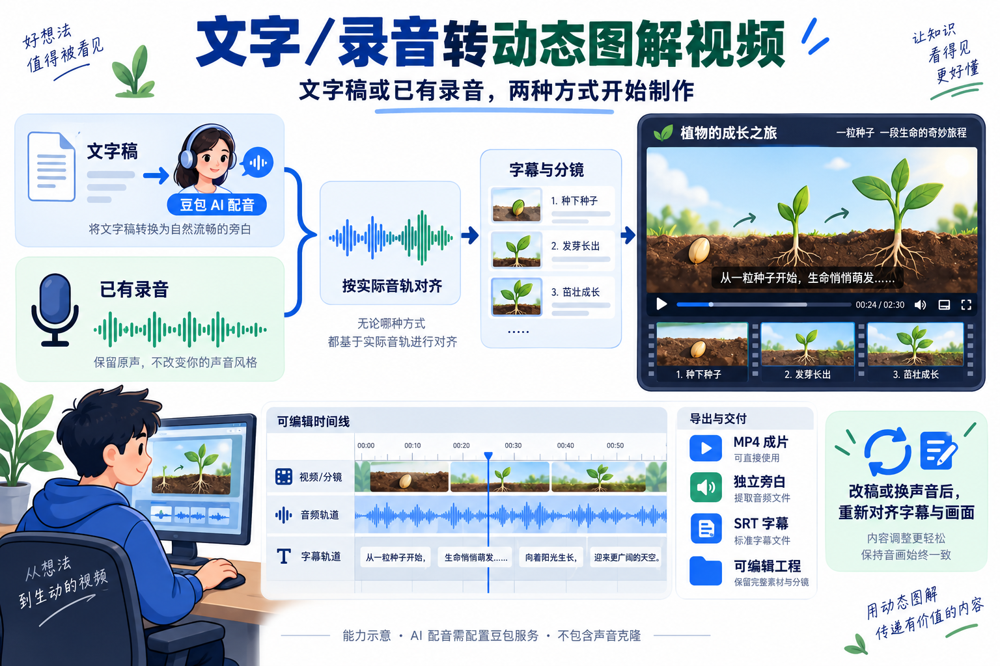
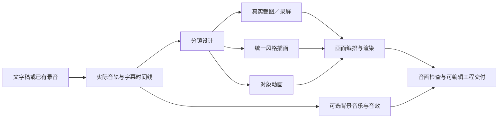
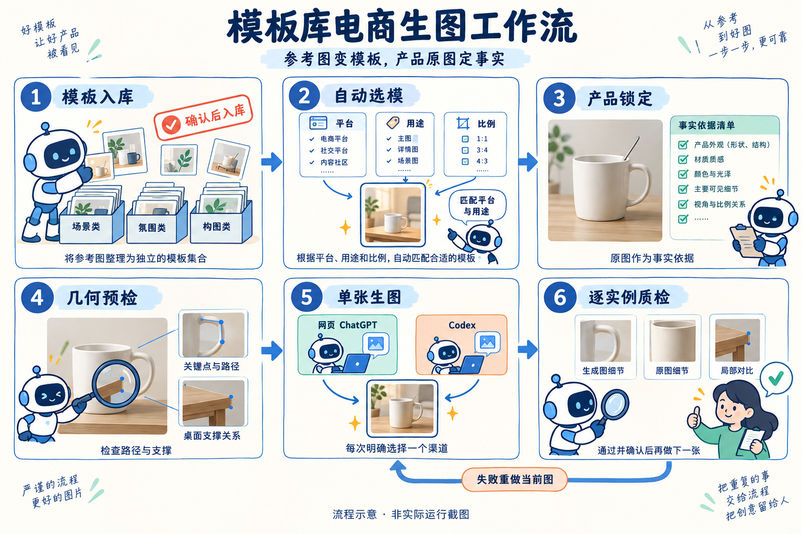
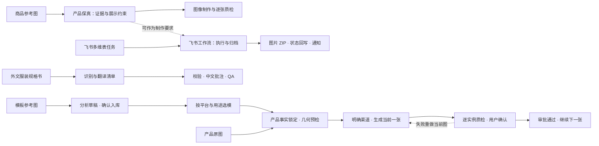
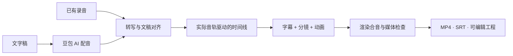

# chris-skills

> **许可限制：** 仅允许个人非商业学习、试用及本地修改。对外分发、发布修改版、重新包装、组织内部业务使用、收费服务及商业内容制作，须事先获得书面授权。修改或改名不自动获得商用权限。
>
> 本项目为**源码公开、限制使用**项目。具体规则见 [LICENSE](LICENSE)；申请方式见[商业及其他授权说明](COMMERCIAL-LICENSE.md)；第三方内容适用[各自权利与许可](THIRD_PARTY_NOTICES.md)。

不吃辣的Chris的个人 AI 工具箱，涵盖电商、视频创作、教育咨询与沟通策略，收录可复用的 Skill、独立工作流和实际案例。后续将持续更新更多 Skill 与工作流，完善现有能力与使用示例。各项内容的归属与许可见对应说明。


*AI 生成的能力概念配图，用于辅助理解各 Skill 与工作流的用途，不是实际运行截图。*

## 项目结构

```text
skills/                      # 可安装到 Agent 的 Skill，按业务分类
  communication/             # 沟通与边界
  ecommerce/                 # 电商与商品资料
  education/                 # 教育咨询
  video/                     # 视频创作
  development/               # 项目开发与知识管理
workflows/                   # 独立运行的工作流工程
  ecommerce/
    ecommerce-template-image-workflow/
assets/                      # README 配图与案例素材
```

`skills/` 通过各自的 `SKILL.md` 使用；`workflows/` 进入工程目录，按 README 安装依赖并运行命令。

## Skills 目录

| 分类 | Skill | 用途 |
| --- | --- | --- |
| 沟通与边界 | [人际冲突与边界应对](skills/communication/deal-with-jerks/SKILL.md) | 处理职场、家庭和社交冲突，整理事实、策略与回复话术。 |
| 电商与商品资料 | [产品保真](skills/ecommerce/preserving-product-fidelity/SKILL.md) | 根据商品原图制作模特图与场景图，逐项核对商品结构、材质和细节。 |
| 电商与商品资料 | [飞书电商生图工作流](skills/ecommerce/feishu-ecommerce-workflow/SKILL.md) | 从飞书多维表读取生图任务，生成图片并归档打包，回写进度和通知负责人。 |
| 电商与商品资料 | [服装规格书中文批注](skills/ecommerce/garment-spec-cn-annotation/SKILL.md) | 上传服装规格书图片，将日文、英文翻译为中文批注，保留原图并输出批注图片。 |
| 教育咨询 | [北京中考志愿填报顾问](skills/education/beijing-zhongkao-admissions-advisor/SKILL.md) | 逐步了解孩子情况，核验对应届别的报考资格与政策，整理升学路径和志愿建议。 |
| 视频创作 | [文字／录音转动态图解视频](skills/video/text-or-voice-to-video/SKILL.md) | 文字稿配音或使用已有录音，结合真实截图、统一插画与对象动画制作讲解视频，可加入背景音乐和音效，交付可编辑工程。 |
| 项目开发 | [项目开发 LLM Wiki](skills/development/project-llm-wiki/SKILL.md) | 搭建项目 Markdown 知识库，摄入资料、查询证据，让开发与排障结果按影响回流。 |

目前收录 6 个 Skill、1 个独立工作流，覆盖沟通、电商、教育咨询与视频创作。

## Workflows 目录

| 分类 | 工作流 | 用途 |
| --- | --- | --- |
| 电商与商品资料 | [模板库电商生图工作流](workflows/ecommerce/ecommerce-template-image-workflow/README.md) | 参考图确认入库、自动选择模板、锁定产品事实、几何预检、单张生成与逐实例质检。 |

工作流工程与 Skill 分开管理；[工作流目录说明](workflows/README.md)包含安装依赖与运行入口。

## 如何选择

| 你遇到的问题 | 推荐 Skill / 工作流 | 主要交付 |
| --- | --- | --- |
| 被甩锅、反复越界，想知道下一步怎么做、怎么回复 | 人际冲突与边界应对 | 局面判断、具体动作、可复制话术、升级条件 |
| AI 商品图看起来漂亮，但结构、材质与实物对不上 | 产品保真 | 产品证据清单、合成或重建结果、制作记录与逐张质检 |
| 电商生图任务散落在表格、聊天和本地文件中 | 飞书电商生图工作流 | 图片、ZIP、任务状态回写、机器人通知 |
| 想复用一套详情图风格，同时逐张核对产品结构与使用状态 | 模板库电商生图工作流（独立工程） | 模板库、选模记录、提示词或网页交接包、候选图片与逐实例质检记录 |
| 日文或英文服装规格书难以交给中文团队执行 | 服装规格书中文批注 | 中文批注 PNG、翻译清单、质检报告 |
| 北京中考信息不完整，不知道如何筛学校、排志愿 | 北京中考志愿填报顾问 | 孩子画像、路径诊断、冲稳保学校池、建议顺序 |
| 只有文字稿，或已有录音，想制作字幕同步的不露脸视频 | 文字／录音转动态图解视频 | MP4、SRT、可编辑工程、来源与 QA 报告 |

## Skill 详细介绍

### 1. 人际冲突与边界应对

[阅读 Skill](skills/communication/deal-with-jerks/SKILL.md) · `deal-with-jerks`

**解决的问题：** 面对甩锅、羞辱、挑衅、道德绑架或反复越界，容易陷入情绪争辩，却不知道怎样澄清责任、拒绝要求或退出关系。

- **功能：** 梳理原话、行为和影响，判断风险与权力差，选择主策略，提供可直接使用的回复，以及再次发生时的升级动作。
- **特点：** 区分事实与推测、情绪与结论；先明确用户目标，再决定是否回复；考虑上下级、家人等必须长期共处的关系。
- **优势：** 将“我很生气”转成少量可执行动作，避免把全部精力花在说服对方上。话术围绕具体事项与边界，便于按场景使用。
- **使用边界：** 不做人格障碍诊断，不承诺改变对方；有威胁或暴力风险时优先安全和支持，不自动联系第三方。

> 示例：使用 deal-with-jerks，帮我处理同事反复把他的任务推给我的情况。我希望保持合作，但明确分工，请给我一条可以直接回复的话和后续动作。

### 2. 产品保真

[阅读 Skill](skills/ecommerce/preserving-product-fidelity/SKILL.md) · `preserving-product-fidelity`

**解决的问题：** 商品替换或场景合成中，AI 容易改变扣具、走线、连接关系、纹理和材质，导致画面好看，却已经不是原来的商品。

- **功能：** 从原图建立产品事实与结构关系，确定有证据支持的展示角度，选择像素复用或证据约束重建方法，检查制作记录，逐张对照原图并复检质量修复结果。
- **特点：** 固定优先级为“产品事实 → 模特与场景不变量 → 接触与遮挡 → 纹理质量 → 风格”；未知结构不能凭常识补全，参考图也需要来源记录。
- **优势：** 把“像不像”拆成可追溯的结构、材质和关键细节检查，让验收有明确依据；首张通过后再扩展整组，有助于控制重复错误。
- **使用边界：** 需要可用的图像工具和足够的商品参考资料。生成结果仍须逐项对照原图检查；结构与材质相似不代表像素完全相同。

> 示例：使用 preserving-product-fidelity，把这款包放进模特手持场景。先核对产品结构与材质，只展示原图支持的角度，保存制作记录并逐张质检。

#### 从输入素材到三张场景输出

**任务：** 以黄色包商品原图为产品依据，替换三张参考图中的包，参考人物、姿势和场景组织画面。参考图编号与输出一一对应。


上排为三张场景参考图，中间为共用商品原图，下排为对应的场景输出。

**Skill 的作用：** 将“把参考图中的包换成这个商品”变成有原图证据、展示约束和逐项验收的制作任务。通过输入与输出对照，可以直观看到商品替换、场景适配及结构与材质核对的作用。

### 3. 飞书电商生图工作流

[阅读 Skill](skills/ecommerce/feishu-ecommerce-workflow/SKILL.md) · `feishu-ecommerce-workflow`

**解决的问题：** 电商团队需要反复从多维表取任务、生成图片、打包、更新状态和通知负责人，人工搬运容易遗漏。

- **功能：** 读取“待处理”或“失败待重试”任务，执行生图、归档与 ZIP 打包、状态回写和机器人通知；支持单次运行、轮询、测试任务和指定任务重跑。
- **特点：** 自带运行程序和环境检查入口，配置独立保存在本机；可先用模拟生图模式检查流程，自动轮询默认关闭。
- **优势：** 将任务入口、执行结果和进度反馈串成完整链路；可先检查流程与配置，再接入真实服务。
- **使用边界：** 真实运行需要飞书权限、凭据与生图服务配置。ERP 报表目前使用模拟数据；已完成任务重跑需要明确确认；真实接口链路需在自己的环境中验证。

> 示例：使用 feishu-ecommerce-workflow，初始化本地运行环境并运行 doctor，先保持 mock 生图模式，帮我定位配置缺项。

从飞书多维表读取任务，经 AI 生图、归档与 ZIP 打包，再回写状态并通知负责人。


> 此图为 AI 生成的流程示意，非实际运行截图。

### 4. 服装规格书中文批注

[阅读 Skill](skills/ecommerce/garment-spec-cn-annotation/SKILL.md) · `garment-spec-cn-annotation`

**解决的问题：** 日文或英文服装技术资料难以直接用于中文协作；直接重绘或随手翻译又可能造成数字变动、漏翻、乱码和批注遮挡。

- **功能：** 读取上传的规格书图片，建立文字识别与翻译清单，区分需要翻译、原样保留、已有中文及待确认内容，统一服装术语，在原文附近添加蓝色中文批注，输出清单与 QA 报告。
- **特点：** 原图作为底图保留，不重绘表格、结构图或尺寸；先完成识别和翻译，再校验与渲染；核对翻译覆盖率、字体缺字和位置遮挡。
- **优势：** 中文说明与原稿可以对照阅读，保留款号、数值和工艺图的上下文；结构化清单便于人工复核和后续修订。
- **使用边界：** 配套脚本承担清单校验与批注渲染，识别和翻译仍由 Agent 或人工完成；模糊内容应标为待确认，不能猜测补全。

> 示例：使用 garment-spec-cn-annotation，处理这张日文缝制规格书。先建立翻译清单，再用蓝色简体中文批注，保留原图和尺寸，输出 PNG 与质检报告。

#### 原稿与中文批注对照

以 **KHJE6075 服装规格书**为例：上传日文规格书截图，识别并翻译文字，在原图附近添加蓝色中文批注，输出批注图片。

**输入：日文规格书截图**


**输出：蓝色中文批注图片**


### 5. 北京中考志愿填报顾问

[阅读 Skill](skills/education/beijing-zhongkao-admissions-advisor/SKILL.md) · `beijing-zhongkao-admissions-advisor`

**解决的问题：** 家长只掌握部分分数、排名和学校信息，面对多种升学路径和网上经验，难以判断哪些规则适用、学校怎么选。

- **功能：** 确认中招届别，逐步补齐孩子画像，联网核验政策和学校信息，分析升学路径，整理冲稳保学校池、建议志愿顺序与提交前确认清单。
- **特点：** 默认一次只问一个问题；检索优先官方政策与学校官方信息；明确区分官方依据、经验判断和信息缺口。
- **优势：** 不要求家长先准备完整档案，能够从零散信息开始咨询；将家庭偏好、资格条件和学校信息放到同一个决策过程中，降低遗漏关键条件的风险。
- **使用边界：** 使用时必须核验对应届别政策，历史分数和网上个例不能直接充当录取门槛；建议顺序需要家长最终人工确认。

> 示例：使用 beijing-zhongkao-admissions-advisor，帮我分析孩子下一届北京中考的志愿方向。我目前只知道所在区和大致成绩，请一次问一个问题，并核验对应届别的官方信息。

从家长掌握的零散信息开始，一次补问一个关键问题，核验对应届别的报考资格和政策，再结合成绩定位与家庭偏好比较升学选择，信息充分后整理志愿建议与复核清单。


> 此图为 AI 生成的能力示意；政策需按届别核验，志愿建议由家长最终复核。

### 6. 文字／录音转动态图解视频

[阅读 Skill](skills/video/text-or-voice-to-video/SKILL.md) · `text-or-voice-to-video`

**解决的问题：** 想把文字或录音制作成不露脸讲解视频，既要处理配音、字幕和分镜，又要让画面解释内容；截图、插画、动画和音乐还需要协调一致，改稿后也要重新对齐。

- **功能：** 文字稿经豆包生成 AI 旁白，或直接使用已有录音；对齐字幕与分镜，组合真实截图／录屏、统一风格插画和对象动画，渲染并检查音画同步；可选添加背景音乐与字幕锚定音效。
- **特点：** 以实际音轨为时间基准，录音模式保留原声；通过对象的移动、连接、对比等变化解释内容，素材记录来源；混音保留独立纯旁白，并在旁白出现时降低背景音乐音量。
- **优势：** 从文字或录音出发，将讲述、证据画面和动画组织到同一工程；可复用动画配方，修改稿件或声音后重新生成时间线，便于继续编辑与追溯素材。
- **视觉检查：** 分镜先明确场景、流程或对比关系；检查关键帧中的对象、文字、连线和状态位置，正式导出前复核当前版本画面，避免通用占位图标和无意义装饰。
- **交付：** MP4、独立纯旁白、SRT、可编辑工程及素材来源与检查报告；使用混音时另附混合音频和混音配置，AI 配音附服务、音色与用量记录。
- **使用边界：** 文字配音需要豆包语音服务 API Key，并按服务规则计费；已有录音无需豆包密钥。视频制作需要 Python、Node、FFmpeg、Whisper 等依赖。截图、插画、音乐和音效需有使用授权；字幕、关键画面及最终听感需复核。

> 文字示例：使用 text-or-voice-to-video，把这份文字稿配成豆包 AI 旁白，结合我的截图和统一风格插画，用对象动画解释关键步骤，制作字幕同步的讲解视频，交付 MP4、旁白、SRT 和可编辑工程。

> 录音示例：使用 text-or-voice-to-video，把这份口播稿和我的录音制作成不露脸讲解视频，保留完整原声，加入已授权的背景音乐并在旁白时降低音乐音量，先检查代表静帧，再输出成片。



*输入流程示意：文字稿生成 AI 旁白，已有录音保留原声。新版可进一步组合以下视觉与声音制作步骤。*



#### 视频示例

以下为文字／录音转视频的能力展示成片，约 60 秒，1920 × 1080、30 fps，展示内容如何结合配音、字幕与动画呈现。


[观看完整示例视频（MP4）](assets/examples/text-or-voice-to-video/text-or-voice-demo.mp4)

### 7. 项目开发 LLM Wiki

[阅读 Skill](skills/development/project-llm-wiki/SKILL.md) · `project-llm-wiki`

**解决的问题：** 项目资料、设计决策与排障经验分散，Agent 在后续任务中反复摸索，修改代码后文档容易过期。

- **功能：** 搭建或接入项目内 Markdown Wiki，摄入资料、建立来源与互链，查询项目知识，并将开发、排障与验证结果回流到受影响页面。
- **特点：** 尊重已有 Wiki 的目录与规则；区分原始资料、知识页面和维护规则，保留来源、未决项与更新日志；支持结构体检。
- **优势：** 项目知识随仓库保存，便于后续 Agent 查证据、执行任务和维护一致性；无需向量数据库或外部服务。
- **使用边界：** 可选脚本需要 Node.js 18+；结构检查不代表事实正确。初始化骨架后仍需摄入真实资料，不收录凭证与敏感信息。

> 示例：使用 project-llm-wiki，为当前项目搭建 LLM Wiki，接入项目任务流程，先摄入架构说明与关键模块资料，再运行结构检查；以后开发完成后同步受影响的知识页。

## 独立工作流详细介绍

### 模板库电商生图工作流

[阅读工作流文档](workflows/ecommerce/ecommerce-template-image-workflow/README.md) · [安装与运行](workflows/README.md) · `ecommerce-template-image-workflow`

**解决的问题：** 详情图风格难复用，参考图、产品图和提示词混在一起；生成图容易改动商品结构，缺少逐张核对和确认步骤。

- **功能：** 将参考图按套组接收、审核入库，按平台、用途、比例及版式等条件选模，记录产品事实与几何预检，生成提示词、网页交接包，或通过已配置的接口生成当前图片，再逐实例裁图质检和审批。
- **特点：** 独立 Python 工程，无 `SKILL.md`；支持 Amazon、淘宝、TikTok Shop 和 Shopify 的模板分类，内置一套 Amazon 示例模板。模板图用于版式与风格，产品原图用于事实；默认一张通过并确认后再继续。
- **优势：** 模板、产品约束、生成与质检材料保存在同一任务目录，便于复用风格、追溯选模原因并重做当前图片。
- **使用边界：** 需要 Python、Pillow 与 PyYAML，测试使用 pytest。原图审查、几何判断与视觉质检仍由 Agent 或人工完成；程序检查记录的一致性。真实生图每次明确选择网页 ChatGPT 或已配置的 Codex 接口；缺少匹配模板、产品事实或通过的预检时停止。内置参考图使用前需核实授权。

> 示例：在 ecommerce-template-image-workflow 工程中，把这组参考图分析成同一套模板，确认后入库。用产品原图锁定结构，先做几何预检，只准备第一张卖点副图，质检并确认后再继续。



*流程示意，非实际运行截图；失败时重做当前图片，通过并确认后再继续下一张。*

## 工作流可视化

以下为流程示意，不是实际生成结果或效果承诺。电商三个 Skill 可以按需求组合，具体衔接仍需配置和任务编排。





## 使用

使用 Skill 时，先打开表格中的 `SKILL.md` 阅读适用范围与依赖。安装时将单个 Skill 的完整目录复制到目标工具的 skills 目录，保留脚本、参考资料、素材和许可文件；不要只复制 SKILL.md。仓库中的分类目录用于管理，不代表工具会自动递归发现。

飞书工作流建议先使用 mock 模式检查配置，再接入飞书与生图服务。各 Skill 的依赖、配置步骤与验证方法见对应目录说明。

独立工作流按 [workflows/README.md](workflows/README.md) 进入工程目录、安装依赖并执行 `python -m workflow.runner --help`。生成配置保存在工程本地的 `image-env.yaml`，不要提交；历史任务输出保存在被忽略的 `projects/` 中。

## 持续更新

后续会继续收录更多 Skill 与独立工作流，并根据实际使用反馈更新源码、文档和示例。可通过仓库 Issues 提交使用问题与功能建议。来源和维护记录见[来源说明](SOURCES.md)与[维护约定](MAINTENANCE.md)。

## 关于我

不吃辣的Chris / AI硬核智识。持续沉淀可复用的创作、学习与自动化工作流。
