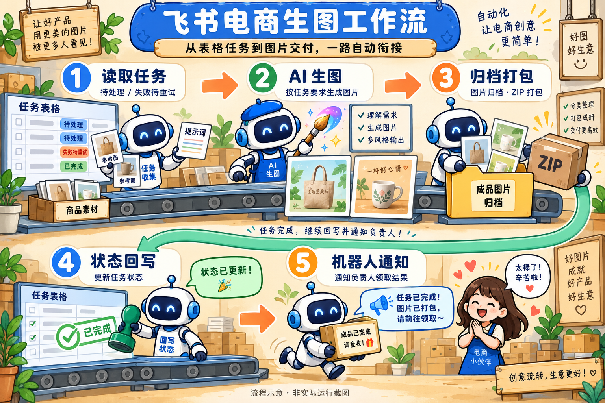
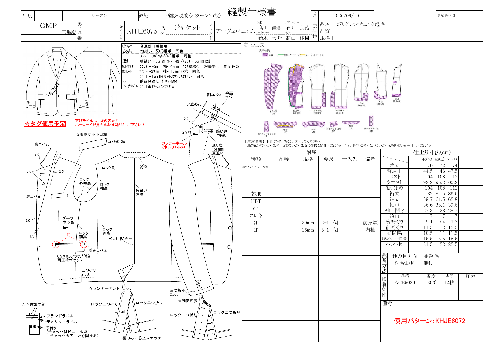
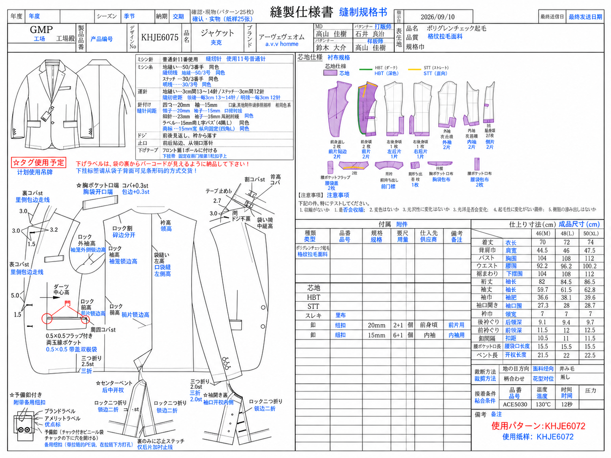
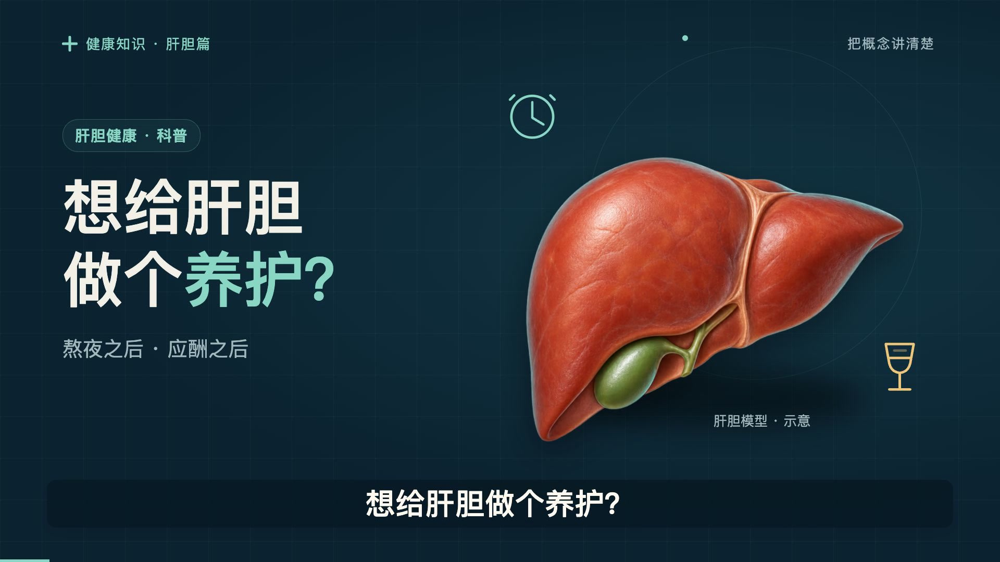
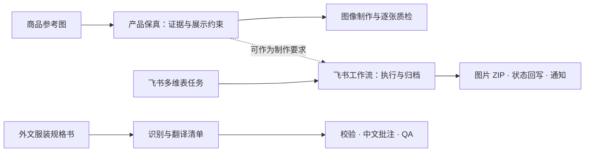

# chris-skills

> **许可限制：** 仅允许个人非商业学习、试用及本地修改。对外分发、发布修改版、重新包装、组织内部业务使用、收费服务及商业内容制作，须事先获得书面授权。修改或改名不自动获得商用权限。
>
> 本项目为**源码公开、限制使用**项目。具体规则见 [LICENSE](LICENSE)；申请方式见[商业及其他授权说明](COMMERCIAL-LICENSE.md)；第三方内容适用[各自权利与许可](THIRD_PARTY_NOTICES.md)。

不吃辣的Chris的个人 AI Skill 工具箱，涵盖电商、视频创作、教育咨询与沟通策略，提供可复用的工作流和实际案例。后续将持续更新更多 Skill，完善现有能力与使用示例。各项内容的归属与许可见对应说明。

*AI 生成的能力概念配图，用于辅助理解各 Skill 的用途，不是实际运行截图。*

## Skills 目录

| 分类 | Skill | 用途 |
| --- | --- | --- |
| 沟通与边界 | [人际冲突与边界应对](skills/communication/deal-with-jerks/SKILL.md) | 处理职场、家庭和社交冲突，整理事实、策略与回复话术。 |
| 电商与商品资料 | [产品保真](skills/ecommerce/preserving-product-fidelity/SKILL.md) | 根据商品原图制作模特图与场景图，逐项核对商品结构、材质和细节。 |
| 电商与商品资料 | [飞书电商生图工作流](skills/ecommerce/feishu-ecommerce-workflow/SKILL.md) | 从飞书多维表读取生图任务，生成图片并归档打包，回写进度和通知负责人。 |
| 电商与商品资料 | [服装规格书中文批注](skills/ecommerce/garment-spec-cn-annotation/SKILL.md) | 上传服装规格书图片，将日文、英文翻译为中文批注，保留原图并输出批注图片。 |
| 教育咨询 | [北京中考志愿填报顾问](skills/education/beijing-zhongkao-admissions-advisor/SKILL.md) | 逐步了解孩子情况，核验对应届别的报考资格与政策，整理升学路径和志愿建议。 |
| 视频创作 | [录音驱动动态图解](skills/video/voice-driven-video/SKILL.md) | 把口播稿和本人录音制作成字幕同步的不露脸动态图解视频，并交付可编辑工程。 |

目前收录 6 个 Skill，覆盖沟通、电商、教育咨询与视频创作。

## 如何选择

| 你遇到的问题 | 推荐 Skill | 主要交付 |
| --- | --- | --- |
| 被甩锅、反复越界，想知道下一步怎么做、怎么回复 | 人际冲突与边界应对 | 局面判断、具体动作、可复制话术、升级条件 |
| AI 商品图看起来漂亮，但结构、材质与实物对不上 | 产品保真 | 产品证据清单、合成或重建结果、制作记录与逐张质检 |
| 电商生图任务散落在表格、聊天和本地文件中 | 飞书电商生图工作流 | 图片、ZIP、任务状态回写、机器人通知 |
| 日文或英文服装规格书难以交给中文团队执行 | 服装规格书中文批注 | 中文批注 PNG、翻译清单、质检报告 |
| 北京中考信息不完整，不知道如何筛学校、排志愿 | 北京中考志愿填报顾问 | 孩子画像、路径诊断、冲稳保学校池、建议顺序 |
| 有口播稿和自己的录音，想做字幕同步的不露脸视频 | 录音驱动动态图解 | MP4、SRT、可编辑工程、来源与 QA 报告 |

## Skill 详细介绍

### 1. 人际冲突与边界应对

[阅读 Skill](skills/communication/deal-with-jerks/SKILL.md) · `deal-with-jerks`

**解决的问题：** 面对甩锅、羞辱、挑衅、道德绑架或反复越界，容易陷入情绪争辩，却不知道怎样澄清责任、拒绝要求或退出关系。

- **功能：** 梳理原话、行为和影响，判断风险与权力差，选择主策略，提供可直接使用的回复，以及再次发生时的升级动作。
- **特点：** 区分事实与推测、情绪与结论；先明确用户目标，再决定是否回复；考虑上下级、家人等必须长期共处的关系。
- **优势：** 将“我很生气”转成少量可执行动作，避免把全部精力花在说服对方上。话术围绕具体事项与边界，便于按场景使用。
- **使用边界：** 不做人格障碍诊断，不承诺改变对方；有威胁或暴力风险时优先安全和支持，不自动联系第三方。

> 示例：使用 deal-with-jerks，帮我处理同事反复把他的任务推给我的情况。我希望保持合作，但明确分工，请给我一条可以直接回复的话和后续动作。

### 2. 产品保真

[阅读 Skill](skills/ecommerce/preserving-product-fidelity/SKILL.md) · `preserving-product-fidelity`

**解决的问题：** 商品替换或场景合成中，AI 容易改变扣具、走线、连接关系、纹理和材质，导致画面好看，却已经不是原来的商品。

- **功能：** 从原图建立产品事实与结构关系，确定有证据支持的展示角度，选择像素复用或证据约束重建方法，检查制作记录，逐张对照原图并复检质量修复结果。
- **特点：** 固定优先级为“产品事实 → 模特与场景不变量 → 接触与遮挡 → 纹理质量 → 风格”；未知结构不能凭常识补全，参考图也需要来源记录。
- **优势：** 把“像不像”拆成可追溯的结构、材质和关键细节检查，让验收有明确依据；首张通过后再扩展整组，有助于控制重复错误。
- **使用边界：** 需要可用的图像工具和足够的商品参考资料。生成结果仍须逐项对照原图检查；结构与材质相似不代表像素完全相同。

> 示例：使用 preserving-product-fidelity，把这款包放进模特手持场景。先核对产品结构与材质，只展示原图支持的角度，保存制作记录并逐张质检。

#### 从输入素材到三张场景输出

**任务：** 以黄色包商品原图为产品依据，替换三张参考图中的包，参考人物、姿势和场景组织画面。参考图编号与输出一一对应。

上排为三张场景参考图，中间为共用商品原图，下排为对应的场景输出。

**Skill 的作用：** 将“把参考图中的包换成这个商品”变成有原图证据、展示约束和逐项验收的制作任务。通过输入与输出对照，可以直观看到商品替换、场景适配及结构与材质核对的作用。

### 3. 飞书电商生图工作流

[阅读 Skill](skills/ecommerce/feishu-ecommerce-workflow/SKILL.md) · `feishu-ecommerce-workflow`

**解决的问题：** 电商团队需要反复从多维表取任务、生成图片、打包、更新状态和通知负责人，人工搬运容易遗漏。

- **功能：** 读取“待处理”或“失败待重试”任务，执行生图、归档与 ZIP 打包、状态回写和机器人通知；支持单次运行、轮询、测试任务和指定任务重跑。
- **特点：** 自带运行程序和环境检查入口，配置独立保存在本机；可先用模拟生图模式检查流程，自动轮询默认关闭。
- **优势：** 将任务入口、执行结果和进度反馈串成完整链路；可先检查流程与配置，再接入真实服务。
- **使用边界：** 真实运行需要飞书权限、凭据与生图服务配置。ERP 报表目前使用模拟数据；已完成任务重跑需要明确确认；真实接口链路需在自己的环境中验证。

> 示例：使用 feishu-ecommerce-workflow，初始化本地运行环境并运行 doctor，先保持 mock 生图模式，帮我定位配置缺项。

从飞书多维表读取任务，经 AI 生图、归档与 ZIP 打包，再回写状态并通知负责人。

> 此图为 AI 生成的流程示意，非实际运行截图。

### 4. 服装规格书中文批注

[阅读 Skill](skills/ecommerce/garment-spec-cn-annotation/SKILL.md) · `garment-spec-cn-annotation`

**解决的问题：** 日文或英文服装技术资料难以直接用于中文协作；直接重绘或随手翻译又可能造成数字变动、漏翻、乱码和批注遮挡。

- **功能：** 读取上传的规格书图片，建立文字识别与翻译清单，区分需要翻译、原样保留、已有中文及待确认内容，统一服装术语，在原文附近添加蓝色中文批注，输出清单与 QA 报告。
- **特点：** 原图作为底图保留，不重绘表格、结构图或尺寸；先完成识别和翻译，再校验与渲染；核对翻译覆盖率、字体缺字和位置遮挡。
- **优势：** 中文说明与原稿可以对照阅读，保留款号、数值和工艺图的上下文；结构化清单便于人工复核和后续修订。
- **使用边界：** 配套脚本承担清单校验与批注渲染，识别和翻译仍由 Agent 或人工完成；模糊内容应标为待确认，不能猜测补全。

> 示例：使用 garment-spec-cn-annotation，处理这张日文缝制规格书。先建立翻译清单，再用蓝色简体中文批注，保留原图和尺寸，输出 PNG 与质检报告。

#### 原稿与中文批注对照

以 **KHJE6075 服装规格书**为例：上传日文规格书截图，识别并翻译文字，在原图附近添加蓝色中文批注，输出批注图片。

**输入：日文规格书截图**

**输出：蓝色中文批注图片**

### 5. 北京中考志愿填报顾问

[阅读 Skill](skills/education/beijing-zhongkao-admissions-advisor/SKILL.md) · `beijing-zhongkao-admissions-advisor`

**解决的问题：** 家长只掌握部分分数、排名和学校信息，面对多种升学路径和网上经验，难以判断哪些规则适用、学校怎么选。

- **功能：** 确认中招届别，逐步补齐孩子画像，联网核验政策和学校信息，分析升学路径，整理冲稳保学校池、建议志愿顺序与提交前确认清单。
- **特点：** 默认一次只问一个问题；检索优先官方政策与学校官方信息；明确区分官方依据、经验判断和信息缺口。
- **优势：** 不要求家长先准备完整档案，能够从零散信息开始咨询；将家庭偏好、资格条件和学校信息放到同一个决策过程中，降低遗漏关键条件的风险。
- **使用边界：** 使用时必须核验对应届别政策，历史分数和网上个例不能直接充当录取门槛；建议顺序需要家长最终人工确认。

> 示例：使用 beijing-zhongkao-admissions-advisor，帮我分析孩子下一届北京中考的志愿方向。我目前只知道所在区和大致成绩，请一次问一个问题，并核验对应届别的官方信息。

从家长掌握的零散信息开始，一次补问一个关键问题，核验对应届别的报考资格和政策，再结合成绩定位与家庭偏好比较升学选择，信息充分后整理志愿建议与复核清单。

> 此图为 AI 生成的能力示意；政策需按届别核验，志愿建议由家长最终复核。

### 6. 录音驱动动态图解

[阅读 Skill](skills/video/voice-driven-video/SKILL.md) · `voice-driven-video`

**解决的问题：** 有稿件和本人录音，但手动剪字幕、卡分镜耗时；换一版录音后，画面和字幕又需要重新调整。

- **功能：** 准备音轨、语音转写、文稿对齐、生成时间线，制作分镜与动态图解，渲染视频、合入原声并检查媒体同步。
- **特点：** 当前录音是唯一时间基准，字幕和场景从时间线读取；保留完整原声；更换录音后重新转写、对齐和渲染，场景随新节奏重排。
- **优势：** 将录音变化传递到字幕与场景，减少分散修改固定时间点的工作；同时交付可编辑工程，方便持续修订和复用。
- **使用边界：** 需要 Python、Node、FFmpeg 和转写等依赖。自动字幕对齐仍需复核关键位置；缺少本人录音时无法按本人节奏定版。

> 示例：使用 voice-driven-video，把这份口播稿和我的录音制作成不露脸动态图解视频，保留完整原声，先检查代表静帧，再交付 MP4、SRT 和可编辑工程。

#### 视频示例

《肝胆养护科普》示例视频约 58 秒，1920 × 1080、30 fps。点击下方 MP4 链接观看完整视频。

[观看完整 MP4 成片](assets/examples/voice-driven-video/liver-science.mp4) · [查看字幕 SRT](assets/examples/voice-driven-video/captions.srt) · [试听原始录音](assets/examples/voice-driven-video/original.m4a) · [查看原始口播稿](assets/examples/voice-driven-video/manuscript.txt)

可结合口播稿、原始录音、字幕与成片，了解“口播稿 + 本人录音 → 字幕 + 动态图解”的制作流程。

## 工作流可视化

以下为流程示意，不是实际生成结果或效果承诺。电商三个 Skill 可以按需求组合，具体衔接仍需配置和任务编排。

## 使用

先打开表格中的 `SKILL.md` 阅读适用范围与依赖。安装时将单个 Skill 的完整目录复制到目标工具的 skills 目录，保留脚本、参考资料、素材和许可文件；不要只复制 SKILL.md。仓库中的分类目录用于管理，不代表工具会自动递归发现。

飞书工作流建议先使用 mock 模式检查配置，再接入飞书与生图服务。各 Skill 的依赖、配置步骤与验证方法见对应目录说明。

## 持续更新

后续会继续收录更多 Skill，并根据实际使用反馈更新工作流、文档和示例。可通过仓库 Issues 提交使用问题与功能建议。来源和维护记录见[来源说明](SOURCES.md)与[维护约定](MAINTENANCE.md)。

## 关于我

不吃辣的Chris / AI硬核智识。持续沉淀可复用的创作、学习与自动化工作流。
