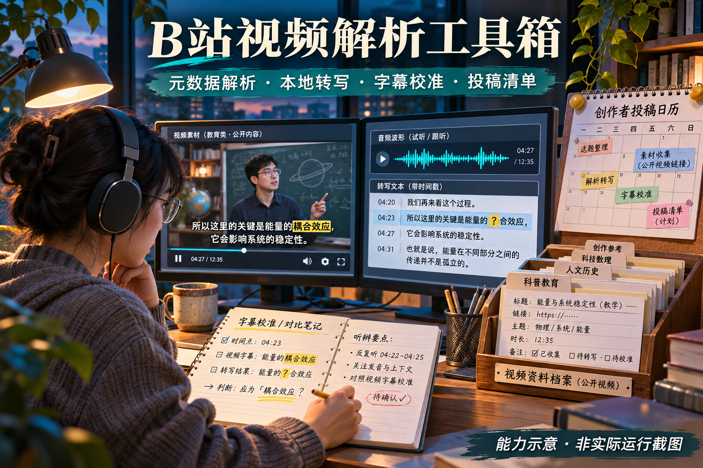

# chris-skills

> **许可限制：** 仅允许个人非商业学习、试用及本地修改。对外分发、发布修改版、重新包装、组织内部业务使用、收费服务及商业内容制作，须事先获得书面授权。修改或改名不自动获得商用权限。
>
> 本项目为**源码公开、限制使用**项目。具体规则见 [LICENSE](LICENSE)；申请方式见[商业及其他授权说明](COMMERCIAL-LICENSE.md)；第三方内容适用[各自权利与许可](THIRD_PARTY_NOTICES.md)。

不吃辣的Chris的个人 AI 工具箱，涵盖电商、视频创作、教育学习与咨询、沟通策略及项目开发，收录可复用的 Skill、独立工作流和实际案例。后续将持续更新更多 Skill 与工作流，完善现有能力与使用示例。各项内容的归属与许可见对应说明。


*此前13项Skill的AI插画总览；本次新增的B站视频解析工具箱见下方目录与详情配图。非实际运行截图，当前收录数量以目录和 catalog.json 为准。*

## 项目结构

```text
skills/                      # 可安装到 Agent 的 Skill，按业务分类
  communication/             # 沟通与边界
  ecommerce/                 # 电商与商品资料
  education/                 # 教育学习与咨询
  video/                     # 视频创作
  development/               # 项目开发与知识管理
workflows/                   # 独立运行的工作流工程
  ecommerce/
    ecommerce-template-image-workflow/
assets/                      # README 配图与案例素材
```

`skills/` 通过各自的 `SKILL.md` 使用；`workflows/` 进入工程目录，按 README 安装依赖并运行命令。

## Skills 目录

| 分类 | Skill | 用途 |
| --- | --- | --- |
| 沟通与边界 | [人际冲突与边界应对](skills/communication/deal-with-jerks/SKILL.md) | 处理职场、家庭和社交冲突，整理事实、策略与回复话术。 |
| 电商与商品资料 | [产品保真](skills/ecommerce/preserving-product-fidelity/SKILL.md) | 根据商品原图制作模特图与场景图，逐项核对商品结构、材质和细节。 |
| 电商与商品资料 | [飞书电商生图工作流](skills/ecommerce/feishu-ecommerce-workflow/SKILL.md) | 从飞书多维表读取生图任务，生成图片并归档打包，回写进度和通知负责人。 |
| 电商与商品资料 | [服装规格书中文批注](skills/ecommerce/garment-spec-cn-annotation/SKILL.md) | 上传服装规格书图片，将日文、英文翻译为中文批注，保留原图并输出批注图片。 |
| 电商与商品资料 | [电商视频爆款拆解](skills/ecommerce/ecommerce-video-breakdown/SKILL.md) | 深度拆解商品种草、测评和带货视频，归纳博主拍法、创作同类商品脚本，并持续更新同一份 Excel。 |
| 电商与商品资料 | [按参考换商品套图](skills/ecommerce/ecommerce-reference-product-swap/SKILL.md) | 按用户提供的主图、SKU与详情参考逐张换商品，保留人物、场景和顺序，核对真实颜色并交付 PNG 套图。 |
| 教育学习与咨询 | [北京中考志愿填报顾问](skills/education/beijing-zhongkao-admissions-advisor/SKILL.md) | 逐步了解孩子情况，核验对应届别的报考资格与政策，整理升学路径和志愿建议。 |
| 教育学习与咨询 | [故事词汇工作室](skills/education/story-vocabulary-studio/SKILL.md) | 按指定词表创作连续原创故事，生成中英阅读、词义回忆、拼写、答案、可选豆包音频与离线学习包。 |
| 视频创作 | [文字／录音转动态图解视频](skills/video/text-or-voice-to-video/SKILL.md) | 文字稿配音或使用已有录音，结合真实截图、统一插画与对象动画制作讲解视频，可加入背景音乐和音效，交付可编辑工程。 |
| 视频创作 | [视频文字跟踪打码](skills/video/video-text-redactor/SKILL.md) | 按指定词语、账号或邮箱等目标逐帧定位、跟踪遮挡，复扫成片并保留原声。 |
| 视频创作 | [视频链接批量归档](skills/video/media-urls-batch-archive/SKILL.md) | 直接接收视频链接或读取任意位置的链接文件，提取字幕或本地转录，按博主和视频归档并支持续跑。 |
| 视频创作 | [B站视频解析工具箱](skills/video/bilibili-toolkit/SKILL.md) | 解析链接、元数据与章节，本地转写口播并用屏幕字幕校准，结合浏览器整理 UP 主公开视频清单。 |
| 项目开发 | [项目开发 LLM Wiki](skills/development/project-llm-wiki/SKILL.md) | 搭建项目 Markdown 知识库，摄入资料、查询证据，让开发与排障结果按影响回流。 |
| 项目开发 | [项目主线导读](skills/development/project-flow-guide/SKILL.md) | 从陌生项目或冗长文档中提炼主流程、关键角色与名称职责，按问题逐步深入。 |

目前收录 14 个 Skill、1 个独立工作流，覆盖沟通、电商、教育学习与咨询、视频创作及项目开发。

## Workflows 目录

| 分类 | 工作流 | 用途 |
| --- | --- | --- |
| 电商与商品资料 | [模板库电商生图工作流](workflows/ecommerce/ecommerce-template-image-workflow/README.md) | 参考图确认入库、自动选择模板、锁定产品事实、几何预检、单张生成与逐实例质检。 |

工作流工程与 Skill 分开管理；[工作流目录说明](workflows/README.md)包含安装依赖与运行入口。

## 如何选择

| 你遇到的问题 | 推荐 Skill / 工作流 | 主要交付 |
| --- | --- | --- |
| 被甩锅、反复越界，想知道下一步怎么做、怎么回复 | 人际冲突与边界应对 | 局面判断、具体动作、可复制话术、升级条件 |
| AI 商品图看起来漂亮，但结构、材质与实物对不上 | 产品保真 | 产品证据清单、合成或重建结果、制作记录与逐张质检 |
| 电商生图任务散落在表格、聊天和本地文件中 | 飞书电商生图工作流 | 图片、ZIP、任务状态回写、机器人通知 |
| 想把参考带货视频拆成可复用拍法，并整理成自己的商品拍摄方案 | 电商视频爆款拆解 | 七表 Excel、博主与视频分析、拍摄脚本、拍前准备、证据与辅助网页 |
| 已有一组可用参考，希望保留原人物和版式，逐张换成自己的商品 | 按参考换商品套图 | 主图、每色 SKU、详情 PNG 套图与长图、原生图、逐屏对照预览和制作记录 |
| 想复用一套详情图风格，同时逐张核对产品结构与使用状态 | 模板库电商生图工作流（独立工程） | 模板库、选模记录、提示词或网页交接包、候选图片与逐实例质检记录 |
| 日文或英文服装规格书难以交给中文团队执行 | 服装规格书中文批注 | 中文批注 PNG、翻译清单、质检报告 |
| 北京中考信息不完整，不知道如何筛学校、排志愿 | 北京中考志愿填报顾问 | 孩子画像、路径诊断、冲稳保学校池、建议顺序 |
| 想让学生在连续故事里学指定英语词汇，并练习回忆与拼写 | 故事词汇工作室 | 六模式离线网页、故事与词表、练习答案、可选真实音频、独立 ZIP |
| 只有文字稿，或已有录音，想制作字幕同步的不露脸视频 | 文字／录音转动态图解视频 | MP4、SRT、可编辑工程、来源与 QA 报告 |
| 视频链接散落在聊天或文件中，想集中提取文字并归档 | 视频链接批量归档 | 每条文字稿、清理稿、来源与元数据，批次汇总、失败清单和续跑日志 |
| 想提取 B 站视频口播、章节，或整理某个 UP 主的公开视频清单 | B站视频解析工具箱 | 视频元数据 JSON、带时间戳逐字稿、OCR 时间轴与修订说明、公开视频链接清单 |
| 接手陌生项目，或被冗长文档淹没，不知道从哪里读起 | 项目主线导读 | 一页概览、主流程、关键角色、名称职责对照与下一步阅读入口 |
| 希望 Agent 持续复用项目资料，并在开发、排障后同步知识 | 项目开发 LLM Wiki | Markdown 知识库、来源与索引、任务验证记录、受影响知识页更新 |

## Skill 详细介绍

### 1. 人际冲突与边界应对

[阅读 Skill](skills/communication/deal-with-jerks/SKILL.md) · `deal-with-jerks`

**解决的问题：** 面对甩锅、羞辱、挑衅、道德绑架或反复越界，容易陷入情绪争辩，却不知道怎样澄清责任、拒绝要求或退出关系。

- **功能：** 梳理原话、行为和影响，判断风险与权力差，选择主策略，提供可直接使用的回复，以及再次发生时的升级动作。
- **特点：** 区分事实与推测、情绪与结论；先明确用户目标，再决定是否回复；考虑上下级、家人等必须长期共处的关系。
- **优势：** 将“我很生气”转成少量可执行动作，避免把全部精力花在说服对方上。话术围绕具体事项与边界，便于按场景使用。
- **使用边界：** 不做人格障碍诊断，不承诺改变对方；有威胁或暴力风险时优先安全和支持，不自动联系第三方。

> 示例：使用 deal-with-jerks，帮我处理同事反复把他的任务推给我的情况。我希望保持合作，但明确分工，请给我一条可以直接回复的话和后续动作。

### 2. 产品保真

[阅读 Skill](skills/ecommerce/preserving-product-fidelity/SKILL.md) · `preserving-product-fidelity`

**解决的问题：** 商品替换或场景合成中，AI 容易改变扣具、走线、连接关系、纹理和材质，导致画面好看，却已经不是原来的商品。

- **功能：** 从原图建立产品事实与结构关系，确定有证据支持的展示角度，选择像素复用或证据约束重建方法，检查制作记录，逐张对照原图并复检质量修复结果。
- **特点：** 固定优先级为“产品事实 → 模特与场景不变量 → 接触与遮挡 → 纹理质量 → 风格”；未知结构不能凭常识补全，参考图也需要来源记录。
- **优势：** 把“像不像”拆成可追溯的结构、材质和关键细节检查，让验收有明确依据；首张通过后再扩展整组，有助于控制重复错误。
- **使用边界：** 需要可用的图像工具和足够的商品参考资料。生成结果仍须逐项对照原图检查；结构与材质相似不代表像素完全相同。

> 示例：使用 preserving-product-fidelity，把这款包放进模特手持场景。先核对产品结构与材质，只展示原图支持的角度，保存制作记录并逐张质检。

#### 从输入素材到三张场景输出

**任务：** 以黄色包商品原图为产品依据，替换三张参考图中的包，参考人物、姿势和场景组织画面。参考图编号与输出一一对应。


上排为三张场景参考图，中间为共用商品原图，下排为对应的场景输出。

**Skill 的作用：** 将“把参考图中的包换成这个商品”变成有原图证据、展示约束和逐项验收的制作任务。通过输入与输出对照，可以直观看到商品替换、场景适配及结构与材质核对的作用。

### 3. 飞书电商生图工作流

[阅读 Skill](skills/ecommerce/feishu-ecommerce-workflow/SKILL.md) · `feishu-ecommerce-workflow`

**解决的问题：** 电商团队需要反复从多维表取任务、生成图片、打包、更新状态和通知负责人，人工搬运容易遗漏。

- **功能：** 读取“待处理”或“失败待重试”任务，执行生图、归档与 ZIP 打包、状态回写和机器人通知；支持单次运行、轮询、测试任务和指定任务重跑。
- **特点：** 自带运行程序和环境检查入口，配置独立保存在本机；可先用模拟生图模式检查流程，自动轮询默认关闭。
- **优势：** 将任务入口、执行结果和进度反馈串成完整链路；可先检查流程与配置，再接入真实服务。
- **使用边界：** 真实运行需要飞书权限、凭据与生图服务配置。ERP 报表目前使用模拟数据；已完成任务重跑需要明确确认；真实接口链路需在自己的环境中验证。

> 示例：使用 feishu-ecommerce-workflow，初始化本地运行环境并运行 doctor，先保持 mock 生图模式，帮我定位配置缺项。

从飞书多维表读取任务，经 AI 生图、归档与 ZIP 打包，再回写状态并通知负责人。


> 此图为 AI 生成的流程示意，非实际运行截图。

### 4. 服装规格书中文批注

[阅读 Skill](skills/ecommerce/garment-spec-cn-annotation/SKILL.md) · `garment-spec-cn-annotation`

**解决的问题：** 日文或英文服装技术资料难以直接用于中文协作；直接重绘或随手翻译又可能造成数字变动、漏翻、乱码和批注遮挡。

- **功能：** 读取上传的规格书图片，建立文字识别与翻译清单，区分需要翻译、原样保留、已有中文及待确认内容，统一服装术语，在原文附近添加蓝色中文批注，输出清单与 QA 报告。
- **特点：** 原图作为底图保留，不重绘表格、结构图或尺寸；先完成识别和翻译，再校验与渲染；核对翻译覆盖率、字体缺字和位置遮挡。
- **优势：** 中文说明与原稿可以对照阅读，保留款号、数值和工艺图的上下文；结构化清单便于人工复核和后续修订。
- **使用边界：** 配套脚本承担清单校验与批注渲染，识别和翻译仍由 Agent 或人工完成；模糊内容应标为待确认，不能猜测补全。

> 示例：使用 garment-spec-cn-annotation，处理这张日文缝制规格书。先建立翻译清单，再用蓝色简体中文批注，保留原图和尺寸，输出 PNG 与质检报告。

#### 原稿与中文批注对照

以 **KHJE6075 服装规格书**为例：上传日文规格书截图，识别并翻译文字，在原图附近添加蓝色中文批注，输出批注图片。

**输入：日文规格书截图**


**输出：蓝色中文批注图片**


### 5. 北京中考志愿填报顾问

[阅读 Skill](skills/education/beijing-zhongkao-admissions-advisor/SKILL.md) · `beijing-zhongkao-admissions-advisor`

**解决的问题：** 家长只掌握部分分数、排名和学校信息，面对多种升学路径和网上经验，难以判断哪些规则适用、学校怎么选。

- **功能：** 确认中招届别，逐步补齐孩子画像，联网核验政策和学校信息，分析升学路径，整理冲稳保学校池、建议志愿顺序与提交前确认清单。
- **特点：** 默认一次只问一个问题；检索优先官方政策与学校官方信息；明确区分官方依据、经验判断和信息缺口。
- **优势：** 不要求家长先准备完整档案，能够从零散信息开始咨询；将家庭偏好、资格条件和学校信息放到同一个决策过程中，降低遗漏关键条件的风险。
- **使用边界：** 使用时必须核验对应届别政策，历史分数和网上个例不能直接充当录取门槛；建议顺序需要家长最终人工确认。

> 示例：使用 beijing-zhongkao-admissions-advisor，帮我分析孩子下一届北京中考的志愿方向。我目前只知道所在区和大致成绩，请一次问一个问题，并核验对应届别的官方信息。

从家长掌握的零散信息开始，一次补问一个关键问题，核验对应届别的报考资格和政策，再结合成绩定位与家庭偏好比较升学选择，信息充分后整理志愿建议与复核清单。


> 此图为 AI 生成的能力示意；政策需按届别核验，志愿建议由家长最终复核。

### 6. 文字／录音转动态图解视频

[阅读 Skill](skills/video/text-or-voice-to-video/SKILL.md) · `text-or-voice-to-video`

**解决的问题：** 想把文字或录音制作成不露脸讲解视频，既要处理配音、字幕和分镜，又要让画面解释内容；截图、插画、动画和音乐还需要协调一致，改稿后也要重新对齐。

- **功能：** 文字稿经豆包生成 AI 旁白，或直接使用已有录音；对齐字幕与分镜，组合真实截图／录屏、统一风格插画和对象动画，渲染并检查音画同步；可选添加背景音乐与字幕锚定音效。
- **特点：** 以实际音轨为时间基准，录音模式保留原声；通过对象的移动、连接、对比等变化解释内容，素材记录来源；混音保留独立纯旁白，并在旁白出现时降低背景音乐音量。
- **优势：** 从文字或录音出发，将讲述、证据画面和动画组织到同一工程；可复用动画配方，修改稿件或声音后重新生成时间线，便于继续编辑与追溯素材。
- **视觉检查：** 分镜先明确场景、流程或对比关系；检查关键帧中的对象、文字、连线和状态位置，正式导出前复核当前版本画面，避免通用占位图标和无意义装饰。
- **主题起稿与动画路线：** 只有主题时可先写口播稿；要求先审稿时，确认后再制作。按镜头需要选择手绘、公式推演、可编程 3D 等代码动画路线，人物通过操作具体对象推动讲解；额外引擎按需配置，不代表默认已安装或验证。
- **发布文案：** 成片同时附推荐标题、话题标签与简介，默认适配小红书，指定平台时按要求调整；文案交付不包含自动发布。
- **交付：** MP4、独立纯旁白、SRT、可编辑工程及素材来源与检查报告；使用混音时另附混合音频和混音配置，AI 配音附服务、音色与用量记录。
- **使用边界：** 文字配音需要豆包语音服务 API Key，并按服务规则计费；已有录音无需豆包密钥。视频制作需要 Python、Node、FFmpeg、Whisper 等依赖。截图、插画、音乐和音效需有使用授权；字幕、关键画面及最终听感需复核。

> 文字示例：使用 text-or-voice-to-video，把这份文字稿配成豆包 AI 旁白，结合我的截图和统一风格插画，用对象动画解释关键步骤，制作字幕同步的讲解视频，交付 MP4、旁白、SRT 和可编辑工程。

> 录音示例：使用 text-or-voice-to-video，把这份口播稿和我的录音制作成不露脸讲解视频，保留完整原声，加入已授权的背景音乐并在旁白时降低音乐音量，先检查代表静帧，再输出成片。


*AI 插画示意：文字稿生成 AI 旁白，已有录音保留原声；成片可进一步组合真实截图、统一插画、对象动画与可选音乐。*

#### 视频示例

以下为文字／录音转视频的能力展示成片，约 60 秒，1920 × 1080、30 fps，展示内容如何结合配音、字幕与动画呈现。


[观看完整示例视频（MP4）](assets/examples/text-or-voice-to-video/text-or-voice-demo.mp4)

### 7. 项目开发 LLM Wiki

[阅读 Skill](skills/development/project-llm-wiki/SKILL.md) · `project-llm-wiki`

**解决的问题：** 项目资料、设计决策与排障经验分散，Agent 在后续任务中反复摸索，修改代码后文档容易过期。

- **功能：** 搭建或接入项目内 Markdown Wiki，摄入资料、建立来源与互链，查询项目知识，并将开发、排障与验证结果回流到受影响页面。
- **特点：** 尊重已有 Wiki 的目录与规则；区分原始资料、知识页面和维护规则，保留来源、未决项与更新日志；支持结构体检。
- **优势：** 项目知识随仓库保存，便于后续 Agent 查证据、执行任务和维护一致性；无需向量数据库或外部服务。
- **交付：** Wiki 索引、知识页面、资料来源账本与更新日志；按任务接入宿主规则入口，并保留实际执行和验证结果。只生成模板骨架不等于知识库已可用。
- **使用边界：** 可选脚本需要 Node.js 18+；结构检查不代表事实正确。初始化骨架后仍需摄入真实资料，不收录凭证与敏感信息。

> 示例：使用 project-llm-wiki，为当前项目搭建 LLM Wiki，接入项目任务流程，先摄入架构说明与关键模块资料，再运行结构检查；以后开发完成后同步受影响的知识页。


*项目主线导读用于快速看懂项目；LLM Wiki 用于把有来源的项目知识保存下来，并在后续任务中查询、验证和维护。收录这个 Skill 不会自动为本仓库创建 Wiki。*

### 8. 视频文字跟踪打码

[阅读 Skill](skills/video/video-text-redactor/SKILL.md) · `video-text-redactor`

**解决的问题：** 录屏中的姓名、账号或联系方式随缩放、滚动和切镜头移动，固定遮挡框容易漏掉目标或遮住其他内容。

- **功能：** 按词语、正则、邮箱／手机号预设、语义类别或指定区域选择目标，逐帧 OCR 定位、运动跟踪打码，并复扫输出视频。
- **特点：** Agent 结合画面理解目标类别，脚本负责识别和遮挡；支持马赛克或纯色覆盖，保留原声，输出规则、检查报告与对比图。
- **优势：** 不要求用户逐个填写姓名坐标；同一视频调整规则时可复用经过校验的 OCR 缓存，便于定位遗漏并重新导出。
- **使用边界：** 当前 OCR 后端仅支持 macOS，需要 Swift 命令行工具、FFmpeg 与 Python 依赖。模糊、长时遮挡等情况仍需人工复核，不保证自动识别所有目标；不用于去掉字幕以恢复原始画面。

> 示例：使用 video-text-redactor，把这段录屏中的第三方博主昵称、账号和邮箱打码，保留标题与正文，检查缩放、滚动和切镜头处，交付打码视频及检查报告。


*AI 能力概念图：跟踪遮挡、保留原声、复查成片；非实际运行截图。*

### 9. 故事词汇工作室

[阅读 Skill](skills/education/story-vocabulary-studio/SKILL.md) · [使用说明](skills/education/story-vocabulary-studio/README.md) · `story-vocabulary-studio`

**解决的问题：** 词表与阅读材料脱节，故事、词义、练习和答案分别制作后容易不一致，续章或改稿时也难追踪旧词复现与音频变化。

- **功能：** 按指定词表和学习水平创作连续原创故事，生成故事阅读、本章词表、词义回忆、拼写练习、英文故事、答案讲解六种模式，并可配豆包单词点读与章节朗读，输出离线网页和 ZIP。
- **特点：** 中英内容、词条与答案使用同一结构化内容源，保留稳定词条 ID 与义项；内容审校记录绑定当前哈希，配音按文本和声线复用缓存。可启用三步学习路径、新语境回顾及错词／未答词重练。
- **优势：** 将故事阅读、主动回忆、拼写和解释放进同一个学习包；续章或改稿后可复核覆盖与答案，并只为变化的英语片段重新配音。
- **交付：** 六模式网页、`book.json`、CSV 词表、质量与音频状态报告，以及按实际完成情况提供的 WAV 音频、独立 ZIP 和 Skill 源文件。
- **使用边界：** 脚本需要 Python 3.10+，仅使用标准库，学习网页可离线打开；真实配音需要豆包 API Key 与音色权限。故事和词义需逐句人工或 Agent 审校，音频需核听；自选示例不能充当完整考试词表，页面作答刷新清空，不代表长期掌握或自动间隔复习。输入模板本身不是成品。

> 示例：使用 story-vocabulary-studio，按我提供的词表和学生水平创作连续原创故事，安排旧词复现，保留中英阅读、词义回忆、拼写和答案讲解。先完成逐义项审校，暂缓配音，交付标明音频待做的离线学习包。


*AI 插画为能力示意；暂缓配音时，内容仍须通过审校，交付包明确标记音频待做。*

### 10. 项目主线导读

[阅读 Skill](skills/development/project-flow-guide/SKILL.md) · `project-flow-guide`

**解决的问题：** 接手陌生项目或阅读冗长资料时，目录、符号和重复说明太多，难以快速抓住主流程与关键职责。

- **功能：** 扫描 README、入口、配置、测试和顶层目录，提炼一至三条主流程，将模块、类名、配置项等名称对应到实际职责，整理一页项目概览。
- **特点：** 先讲主线，再解释关键角色与名称；标明暂时可跳过的内容和下一步阅读入口，追问时只展开相关分支。
- **优势：** 把分散的项目材料组织成便于理解与继续核查的阅读路径，减少重复说明与无关细节。
- **使用边界：** 需要提供可读取的项目或文档；概览依据实际材料，无法确认的内容须标明。技能本身没有执行脚本，无需额外运行时；不替代代码验证或持久知识库维护。

> 示例：使用 project-flow-guide，先读这个项目的 README、入口和顶层目录，用一页说明主流程、关键模块及各自职责，列出暂时可跳过的内容和下一步最值得读的文件。后续只展开我追问的分支。


*AI 插画为能力示意，具体主线与阅读入口以实际项目资料为准。*

### 11. 电商视频爆款拆解

[阅读 Skill](skills/ecommerce/ecommerce-video-breakdown/SKILL.md) · [独立运行与初始化](skills/ecommerce/ecommerce-video-breakdown/references/runtime.md) · `ecommerce-video-breakdown`

**解决的问题：** 看过种草、测评或带货视频后，只记住表面形式，难以解释内容如何说服用户、哪些拍法可迁移，以及怎样转成适合自己商品的拍摄方案。

- **功能：** 解析或导入抖音、小红书、B站的匿名公开视频与本地资料，核对视频身份、文字稿和画面证据，拆解内容节奏与商品表达，归纳博主拍法并生成同类商品的拍摄脚本和拍前准备。
- **特点：** 分析由 Agent 实际阅读资料、检查画面完成；原片观察与新创作方案分别记录。新链接完成分析后持续追加或更新同一份 Excel，保留人工备注、自建列和工作表。
- **交付：** `电商视频分析总表.xlsx`，含博主汇总、视频索引、博主分析、视频拆解、拍法库、拍摄脚本、拍前准备七张表，另附证据索引与辅助 HTML/Markdown 报告。
- **优势：** 从参考内容的证据出发，把拆解、拍法积累与原创拍摄准备放在同一工作区；完整技能包内置 Python 取材管线和 Excel 生成代码，字幕、本地转录、六帧取材及缓存均随包提供，可独立复制使用。
- **使用边界：** 需要 Python 3.9+；在线解析与抽帧依赖 FFmpeg、FFprobe、yt-dlp，转录按需准备本地 Whisper。已有本地资料可先导入，缺宿主表格工具或 Node 时使用随包标准库写入器。仅使用匿名公开内容或本地素材，禁止登录态；匿名访问失败时记录原因并改用本地导入。分析与新脚本仍需结合真实商品核验，不保证爆款或转化结果。

> 示例：使用 ecommerce-video-breakdown，拆解我提供的三条同类商品视频，核对口播和关键画面，归纳可复用的拍法与迁移条件，整理我方商品待补事实、拟拍脚本和拍前准备，并更新同一个工作区里的 Excel；无法匿名解析的链接先列出，改用我提供的本地资料。


*AI 生成的能力概念图，非实际运行截图；原视频、分析结论与拍摄方案须分别核对。*

### 12. 视频链接批量归档

[阅读 Skill](skills/video/media-urls-batch-archive/SKILL.md) · [独立安装与迁移](skills/video/media-urls-batch-archive/references/migration.md) · `media-urls-batch-archive`

**解决的问题：** 视频链接散落在聊天、分享文案和本地文件里，逐条提取文字、整理博主与视频目录、记录失败和重新执行都需要重复操作。

- **功能：** 直接接收多个链接，或读取任意目录中的 UTF-8 链接文件；提取字幕，无字幕时进行本地语音转录，按博主与视频归档。保留输入文件，链接去重，完成项默认跳过，失败项可继续处理。
- **特点：** 自带输入处理、字幕格式解析、转录调度、缓存、归档和环境初始化代码，不需要其他 Skill 或原项目。目录中有多个链接文件时先选择；输出位置由本次任务明确指定。
- **交付：** 每条包含原始文字稿、清理稿、来源链接、元数据与介绍；根目录保存汇总、失败记录和日志，按需抽帧并将画面复制进对应归档。
- **优势：** 整个技能目录可单独搬到新电脑，初始化后继续使用；已完成与失败条目分别保留，避免重复处理与空稿被误报为成功。
- **使用边界：** 需要 Python 3.11+，推荐 3.12；首次联网初始化会安装下载工具、按需取得 FFmpeg/FFprobe 并准备本地转录模型。平台接入依赖 yt-dlp 等工具，实际可用性取决于平台访问条件和网络；仅字幕模式不包含无字幕视频转录，迁移包不是离线依赖全集。

> 示例：使用 media-urls-batch-archive，读取我指定目录中的视频链接文件，一行一条，先确认实际文件与输出位置，提取字幕或本地转录，按博主和视频整理；已有完整结果跳过，最后列出失败原因与保存目录。


*AI 生成的档案工作室概念图，非实际运行截图；解析与转录结果须以真实输出和失败记录为准。*

### 13. 按参考换商品套图

[阅读 Skill](skills/ecommerce/ecommerce-reference-product-swap/SKILL.md) · [素材接收](skills/ecommerce/ecommerce-reference-product-swap/references/input-and-references.md) · [导出契约](skills/ecommerce/ecommerce-reference-product-swap/references/export-contract.md) · `ecommerce-reference-product-swap`

**解决的问题：** 已有可用的主图、SKU或详情参考，想逐张换成当前商品，却容易改变原人物、姿势、场景和版式，或者遗漏真实颜色与原参考屏。

- **功能：** 接收本次商品实拍、资料与用户提供的有权使用参考，按上传顺序逐屏映射，明确保留项和替换项，编辑后逐张检查商品、人物、版式、文字和颜色。
- **特点：** 当前商品原资料决定结构、材质、参数和真实颜色，参考图决定版式与需保留的人物场景；没有预置商品、历史模板或默认案例。主图数量、SKU风格位置及详情人物策略按本次要求确认。
- **交付：** PNG 主图、每个真实颜色的 SKU 图、详情单图与长图、原生图、逐屏参考对照 HTML，以及提示词、来源绑定和检查记录；只要求一类时仅交付该类。
- **优势：** 保留原参考组的次序与对应关系，用同一商品键和颜色清单约束三类图集，独立导出脚本检查数量、顺序、哈希、颜色覆盖和比例。
- **使用边界：** 需要用户提供可用参考及足够商品事实，图像编辑能力由宿主提供；默认使用内置 imagegen，不能因工具缺失自行换服务。导出需要 Python 3.10+ 与 Pillow；脚本校验不能代替实际看图、素材授权或浏览器交付复核。

> 示例：使用 ecommerce-reference-product-swap，按我上传的参考顺序制作这款商品的主图、各色 SKU 与详情套图，保留每屏原人物、姿势、场景和版式；先核对真实颜色和数量，首屏检查通过后继续，最终导出 PNG、详情长图与逐屏对照预览。


*AI 生成的设计工作室概念图，非实际成品对照；任务素材由用户提供，文件校验不代替商品与人物保真检查。*

### 14. B站视频解析工具箱

[阅读 Skill](skills/video/bilibili-toolkit/SKILL.md) · [UP 主清单参考](skills/video/bilibili-toolkit/references/up-all-videos.md) · `bilibili-toolkit`

**解决的问题：** 希望从 B 站视频取得标题、章节与口播文字，或整理某个 UP 主的公开视频链接，便于阅读、检索和后续研究。

- **功能：** 解析 BV 号、完整链接及短链，读取元数据与章节；下载音频后用 faster-whisper 本地转写，可抽帧 OCR 辅助核对屏幕字幕；投稿清单通过合集信息、浏览器翻页与元数据补全整理。
- **交付：** 元数据 JSON、带时间戳逐字稿、修订及存疑说明、OCR 时间轴 JSON 与去重文本、公开视频链接清单。
- **依赖：** 原包推荐 Python 3.12，示例使用 Windows `py -3.12` 与 `.venv_bili/Scripts/python`；macOS/Linux 需按本机环境改用 `python3.12` 与 `.venv_bili/bin/python`。转写/OCR 依赖 faster-whisper、PyAV、rapidocr-onnxruntime、Pillow 和模型下载；原包指定的版本与镜像是来源经验，本次未安装或实测。
- **使用边界：** 平台访问与接口状态可能变化；官方 AI 字幕可能需要用户在浏览器登录，本地转写仍需人工复核。UP 主清单只覆盖公开可见投稿，需额外的 `browser-use:control-browser` 技能及兼容浏览器环境，包内没有完整自动采集器。文档提及的 WBI 签名函数未随脚本交付；不据此宣称具备签名能力或保证获取全部投稿。用户内容与账号权限由使用者自行管理。

> 示例：使用 bilibili-toolkit，提取这个 B 站视频的元数据和口播逐字稿，保留时间戳；如需本地转写，标出存疑词语，并说明哪些地方参考了屏幕字幕。



*AI 生成的能力概念图，非实际运行截图，不代表平台访问或识别准确率验证。*

## 独立工作流详细介绍

### 模板库电商生图工作流

[阅读工作流文档](workflows/ecommerce/ecommerce-template-image-workflow/README.md) · [安装与运行](workflows/README.md) · `ecommerce-template-image-workflow`

**解决的问题：** 详情图风格难复用，参考图、产品图和提示词混在一起；生成图容易改动商品结构，缺少逐张核对和确认步骤。

- **功能：** 将参考图按套组接收、审核入库，按平台、用途、比例及版式等条件选模，记录产品事实与几何预检，生成提示词、网页交接包，或通过已配置的接口生成当前图片，再逐实例裁图质检和审批。
- **特点：** 独立 Python 工程，无 `SKILL.md`；支持 Amazon、淘宝、TikTok Shop 和 Shopify 的模板分类，内置一套 Amazon 示例模板。模板图用于版式与风格，产品原图用于事实；默认一张通过并确认后再继续。
- **优势：** 模板、产品约束、生成与质检材料保存在同一任务目录，便于复用风格、追溯选模原因并重做当前图片。
- **使用边界：** 需要 Python、Pillow 与 PyYAML，测试使用 pytest。原图审查、几何判断与视觉质检仍由 Agent 或人工完成；程序检查记录的一致性。真实生图每次明确选择网页 ChatGPT 或已配置的 Codex 接口；缺少匹配模板、产品事实或通过的预检时停止。内置参考图使用前需核实授权。

> 示例：在 ecommerce-template-image-workflow 工程中，把这组参考图分析成同一套模板，确认后入库。用产品原图锁定结构，先做几何预检，只准备第一张卖点副图，质检并确认后再继续。


*流程示意，非实际运行截图；失败时重做当前图片，通过并确认后再继续下一张。*

## 使用

使用 Skill 时，先打开表格中的 `SKILL.md` 阅读适用范围与依赖。安装时将单个 Skill 的完整目录复制到目标工具的 skills 目录，保留脚本、参考资料、素材和许可文件；不要只复制 SKILL.md。仓库中的分类目录用于管理，不代表工具会自动递归发现。

飞书工作流建议先使用 mock 模式检查配置，再接入飞书与生图服务。各 Skill 的依赖、配置步骤与验证方法见对应目录说明。

独立工作流按 [workflows/README.md](workflows/README.md) 进入工程目录、安装依赖并执行 `python -m workflow.runner --help`。生成配置保存在工程本地的 `image-env.yaml`，不要提交；历史任务输出保存在被忽略的 `projects/` 中。

## 持续更新

后续会继续收录更多 Skill 与独立工作流，并根据实际使用反馈更新源码、文档和示例。可通过仓库 Issues 提交使用问题与功能建议。来源和维护记录见[来源说明](SOURCES.md)与[维护约定](MAINTENANCE.md)。

## 关于我

不吃辣的Chris / AI硬核智识。持续沉淀可复用的创作、学习与自动化工作流。
